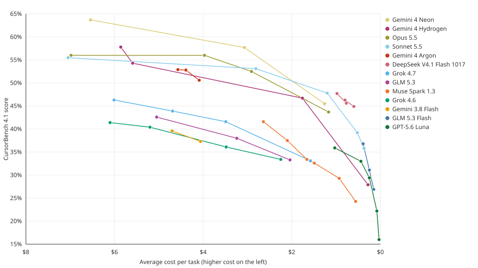

# Cursor Bench

This plot only includes models I'm currently using. Hover or tap a point for the model name and effort. Numbers are from [CursorBench 4.0](https://cursor.com/cursorbench) (snapshot 18 Nov 2026), except for Gemini 3.8 Flash which is retained from the 4 Nov 2026 snapshot as it is no longer listed. Opus 5.5 Max (57.8%, $13.43) is omitted from the plot to keep the cost axis compact.

